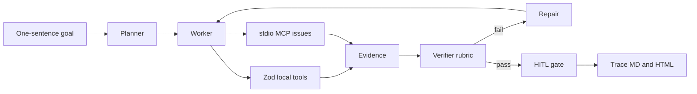

# ForgeFlow

ForgeFlow turns one sentence into a checkable pull request: OpenAI calls the tools, and a verifier accepts only claims copied from tool output.

OpenAI is the live demo. With `OPENAI_API_KEY` set, `pnpm demo` calls the Responses API, which uses function tools to read this repo and a strict JSON schema for the audit. Without a key, the same command runs a deterministic offline mock, so the fail, repair, and pass trace still runs with no network.

## Quickstart

Live, when a key is available:

```bash
pnpm install
cp .env.example .env
pnpm demo
```

Put `OPENAI_API_KEY` in `.env`. `OPENAI_MODEL` is optional and defaults to `gpt-5.6-luna`. Stdout starts with `demo mode: live`.

Offline:

```bash
pnpm install
pnpm test
pnpm demo:mock
pnpm eval
```

`pnpm demo` with no key prints `demo mode: mock (offline fallback; OPENAI_API_KEY is not set)` and then the same transcript as `pnpm demo:mock`: `intentional draft-pr FAIL`, `repair 1`, `repairs=1`, `verdict pass`. The run writes [artifacts/last-run.md](artifacts/last-run.md) and [artifacts/last-run.html](artifacts/last-run.html). Open the HTML for the camera. The sticky header is **verdict pass**. The banner reads FAIL → repair 1 → PASS.

Full 3-minute camera script: [DEMO.md](DEMO.md).

## For judges

`pnpm demo` is the headline. With `OPENAI_API_KEY` set it calls the OpenAI Responses API: function tools first, then a strict JSON schema named `forgeflow_audit`. The first stdout line is `demo mode: live`. Without a key the same command prints `demo mode: mock` and runs the offline proof.

Deterministic checks, all offline:

```bash
pnpm test
pnpm demo:mock
pnpm eval
```

`pnpm demo:mock` must print, in order, `intentional draft-pr FAIL`, `repair 1`, `repairs=1`, and `verdict pass`. Open `artifacts/last-run.html`. The sticky header is **verdict pass**.

The first `draft_pr` failure is intentional. Leave it in place. A repaired claim must be an exact substring of tool output. High-severity issues `#12` and `#18` must be cited. The checklist must cover tests, docs, risk, and rollback. Do not commit an API key.

## Problem

A fluent PR can still be ungrounded. It can skip the README, cite no issues, and claim the change has zero risk without a tool ever saying that. Judges are left trusting the prose.

ForgeFlow makes that failure visible, then repairs it from tool output only. The first `draft_pr` is an intentional gap: no README quote, no issue numbers, a checklist that says "Ship it", and an unsupported claim. One repair drafts again from the tool corpus. The verifier accepts a claim only when it is an exact substring of tool output. High-severity issues must be cited. The checklist must cover tests, docs, risk, and rollback.

Do not remove the first-draft failure. The mock path expects `repairs=1`.

## Architecture



| Role | What the mock does |
| --- | --- |
| Planner | `createPlan` assigns an ordered workflow. Every step is tagged `local` or `mcp`. |
| Worker | Runs the plan. Local tools use Zod. Issue tools go through a stdio MCP server spawned with a scrubbed environment. |
| Verifier | Scores the draft against tool output. Coverage is an exact substring, not a paraphrase. |
| Repair | Re-drafts once from the README quote and the MCP issue records. Attempt 1 stays an intentional fail. |
| HITL | Approves a passing draft. `FORGEFLOW_HITL=deny` or `--hitl deny` rejects it. |

Mock mode never calls the network. Issues come from [fixtures/issues.json](fixtures/issues.json). No GitHub token.

## Verifier

| Check | Passes when |
| --- | --- |
| `title` | Names the audit and the README |
| `summary-quote` | Backtick quote of at least 24 characters copied from `read_readme` |
| `issue-citations` | Every high-severity open issue is cited, and every cited number was returned by a tool |
| `checklist-gates` | The checklist contains tests, docs, risk, and rollback |
| `evidence-map` | The map names a successful local call and a successful mcp call |
| `coverage` | Every claim is an exact substring of the tool corpus |
| `no-gap` | The intentional-gap marker is gone |

The fixture's high-severity issues are `#12` and `#18`. `#27` is medium and is listed with the other open issues, but the gate is the high-severity pair.

## OpenAI tools and MCP

| Piece | Mock judge path | Live path |
| --- | --- | --- |
| Planner | `createPlan` assigns steps and `local` / `mcp` kinds | The model follows the live instructions and must call tools |
| Local tools | Zod schemas: `read_readme`, `list_files`, `draft_pr` | Responses function tools built from the same Zod schemas |
| Issue tools | stdio MCP: `list_open_issues`, `get_issue` | Same MCP server, invoked when the model calls those tools |
| Verifier | Rubric + exact-substring coverage | Second Responses call, strict JSON schema `forgeflow_audit` |
| Repair | One deterministic re-draft | Not scripted; the mock owns the fail-then-repair beat |
| HITL | Auto-approve after a pass. `FORGEFLOW_HITL=deny` or `--hitl deny` rejects | The mock gate is the demo |
| Trace | `artifacts/last-run.md` and `.html` | Audit text on stdout, prefixed with `demo mode: live` |

Live calls use the OpenAI Node SDK (`openai`) Responses API: function tools, then a strict `json_schema` text format. `@openai/agents` 0.21 remains the agent SDK pin. The server is [src/mcp-server/index.ts](src/mcp-server/index.ts).

## Live mode

`pnpm demo` selects the mode from the environment:

- `OPENAI_API_KEY` set: OpenAI Responses API. The model is `OPENAI_MODEL` or `gpt-5.6-luna`. The first call sends function tools (`read_readme`, `list_files`, `list_open_issues`, `get_issue`) with `tool_choice: required`. ForgeFlow runs those tools locally and through the stdio MCP server, then asks for a strict `forgeflow_audit` JSON schema.
- Key unset: offline mock. Stdout says `demo mode: mock` and includes the fallback reason.

`pnpm demo:mock` always runs the mock. `pnpm demo:live` always calls the API and exits 2 when the key is missing. Do not put a key in the repo. Copy [.env.example](.env.example) to `.env` locally.

Optional knobs, all unset on the scored mock path:

- `pnpm demo:mock -- --hitl deny` rejects a draft that already passed the rubric. Exit code 1 is expected.
- `FORGEFLOW_MAX_REPAIRS` is an integer from 0 to 4. The default is 2, which leaves room for the one repair the mock path needs.
- A typo in `FORGEFLOW_MODE`, `FORGEFLOW_HITL`, or `FORGEFLOW_MAX_REPAIRS` exits 2 instead of silently changing the demo. `pnpm demo` chooses live or mock from `OPENAI_API_KEY`, not from `FORGEFLOW_MODE`.

## MCP server

```bash
pnpm exec tsx src/mcp-server/index.ts
```

Spawn that command for a client. It speaks MCP on stdin/stdout and writes nothing else to stdout. `pnpm mcp` runs the same file, but pnpm's own script banner is not protocol-safe, so clients should use `pnpm exec`. Tools:

- `list_open_issues` `{ repo }` — open issues from the fixture. `repo` is a label; the fixture is the only issue set.
- `get_issue` `{ repo, number }` — one issue, or an error if the number is unknown.

The mock worker spawns this same entry with `tsx` and a scrubbed environment. The child does not receive `OPENAI_API_KEY`.

## Layout

`src/agent` plans, works, verifies, and repairs. `src/tools` holds Zod local tools and the MCP bridge. `src/verify` is the rubric and coverage check. `src/cli.ts` is the judge entry. `evals/cases` holds the golden workflow plus regressions that fail a draft missing rollback, citing issue `#999`, or adding an unsupported claim.
