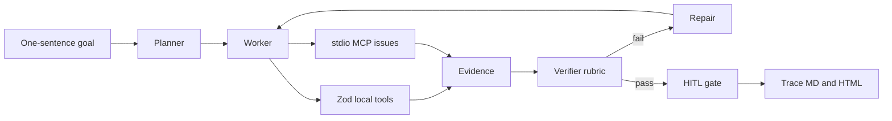

# ForgeFlow

ForgeFlow turns one sentence into a checkable tool workflow.

**Judged sentence:** a planner maps that sentence onto local Zod tools and an MCP issue server, the worker drafts a PR, the verifier rejects the first draft on purpose, one repair passes, and the trace shows the evidence.

Speak from [DEMO.md](DEMO.md) (0:00–3:00). The scored path is offline.

## Quick start

```bash
pnpm install
pnpm test
pnpm demo:mock
```

`pnpm demo:mock` prints the plan, tags each tool `local` or `mcp`, shows the intentional `draft-pr FAIL`, then `repair 1`, `repairs=1`, and `verdict pass`. It writes [artifacts/last-run.md](artifacts/last-run.md) and [artifacts/last-run.html](artifacts/last-run.html). Open the HTML on the recording.

```bash
pnpm eval          # golden workflow + offline rubric regressions
pnpm exec tsx src/mcp-server/index.ts   # stdio MCP, stdout kept clean for clients
pnpm demo:live     # optional OpenAI Agents run; needs OPENAI_API_KEY
```

## Architecture



Mock mode never calls the network. The planner is deterministic, the worker executes the plan, and the verifier is a rubric over tool output. The first `draft_pr` is an intentional gap (no README quote, no issue numbers, checklist is "Ship it", plus an unsupported claim). The repair drafts only from the tool corpus. High-severity issues `#12` and `#18` must be cited. The checklist must cover tests, docs, risk, and rollback.

## OpenAI tools and MCP

| Piece | Mock judge path | Live path |
| --- | --- | --- |
| Planner | `createPlan` assigns steps and `local` / `mcp` kinds | Same tools, model follows `LIVE_INSTRUCTIONS` |
| Local tools | Zod schemas: `read_readme`, `list_files`, `draft_pr` | `@openai/agents` `tool()` with the same schemas |
| Issue tools | stdio MCP: `list_open_issues`, `get_issue` | `MCPServerStdio` pointed at `pnpm mcp` |
| Verifier | Rubric + exact-substring coverage | Instructions ask the model to cite tool output |
| Repair | One deterministic re-draft | Not scripted; mock owns the fail-then-repair beat |
| HITL | Auto-approve after a pass; `FORGEFLOW_HITL=deny` rejects | SDK `needsApproval` is available; mock gate is the demo |
| Trace | `artifacts/last-run.md` and `.html` | Model text on stdout |

SDK pin: `@openai/agents` 0.21. Issues come from [fixtures/issues.json](fixtures/issues.json), served by [src/mcp-server/index.ts](src/mcp-server/index.ts). No GitHub token.

## Live mode and geography

`pnpm demo:live` calls `api.openai.com`. OpenAI geo-blocks that API from mainland China and some other networks, so a live call can fail even with a valid key. Do not put a key in the repo. Copy [.env.example](.env.example) to `.env` locally if you have a key. Judges should score `pnpm demo:mock` and, if they want a recording, the terminal transcript plus `artifacts/last-run.html`. Do not commit API keys or screen recordings.

## MCP server

```bash
pnpm exec tsx src/mcp-server/index.ts
```

Spawn that command for a client. It speaks MCP on stdin/stdout and writes nothing else to stdout. `pnpm mcp` runs the same file, but pnpm's own script banner is not protocol-safe, so clients should use `pnpm exec`. Tools:

- `list_open_issues` `{ repo }` — open issues from the fixture
- `get_issue` `{ repo, number }` — one issue, or an error if the number is unknown

The mock worker spawns this same entry with `tsx` and a scrubbed environment (no API key).

## Layout

`src/agent` plans, works, verifies, and repairs. `src/tools` holds Zod local tools and the MCP bridge. `src/verify` is the rubric and coverage check. `evals/cases` holds the golden workflow plus regressions that fail a draft missing rollback, citing issue `#999`, or adding an unsupported claim.
